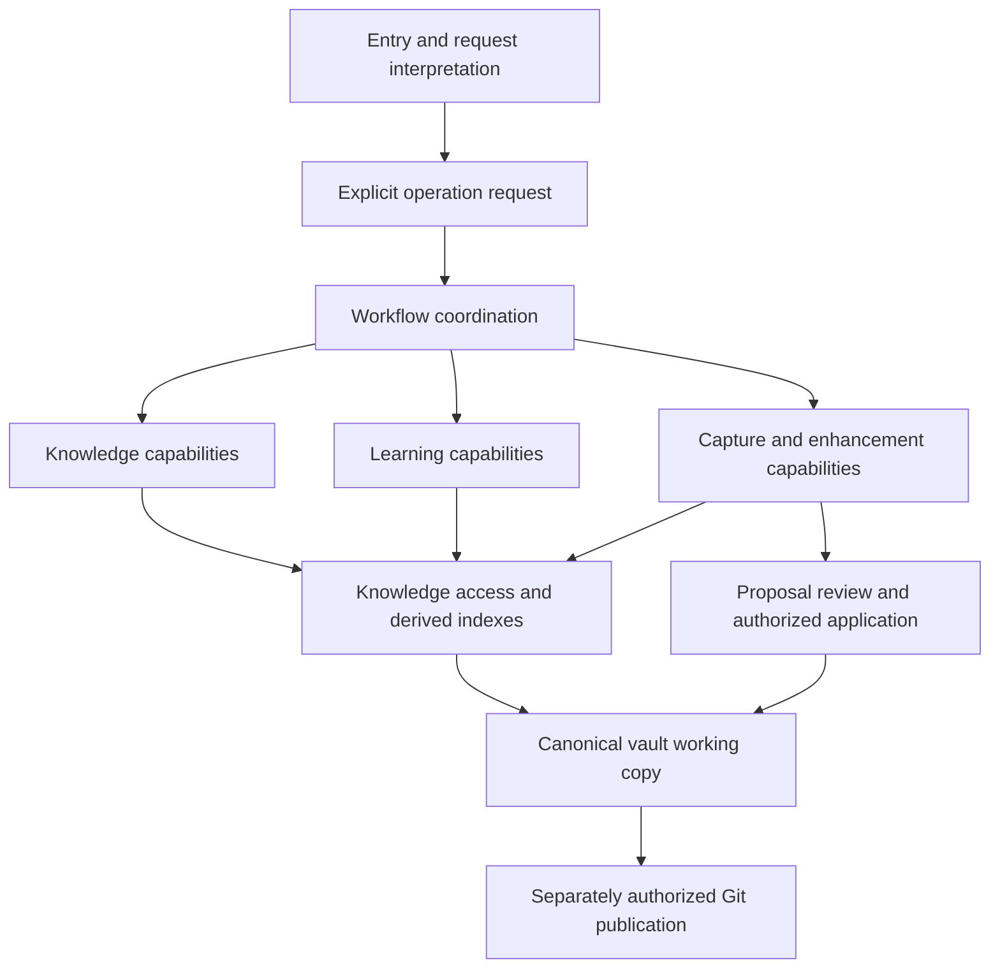

# Workflow architecture: first draft

Recorded: 2026-10-31. Status: proposed architecture for discussion, not approved implementation.

## Scope and authority

The user authorized starting architecture drafting and clarified that revision is an example, not the platform's entire scope. Use the captured inventory as a working baseline, investigate targeted gaps, and retain the audit's limits; this is not a claim of exhaustive inventory acceptance. PKM and Learning remain initial priorities, with future domains preserved as candidates.

This draft proposes logical responsibilities, not Java interfaces, Gradle modules, services, deployment boundaries or repository scaffolding. Decisions 001–004 continue to govern. No successor implementation or vault is created.

## Discussion outcomes and status

| Item | Status and origin |
|---|---|
| Offer an understanding check before guided revision, one question at a time, up to three, with skip available throughout | User accepted as a provisional default, 2026-10-31 |
| Answers tailor the current session independently of saving learning progress | User accepted as a provisional default; storage/retention policy not selected |
| Immediate brief feedback, adaptive next question, then focused recap | Assistant recommendation after user delegated the uncertain choice; proposed and revisable |
| Guided revision, quick recap, quiz me and independent reading | Proposed experience options; not four separate implementations |
| Quiz feedback after each answer, optional test mode with feedback at the end | Proposed; detailed assessment design open |
| Architecture must support workflows beyond this example | Explicit user clarification |

An understanding check helps choose teaching depth; a quiz provides practice. They can reuse question/feedback capabilities. Teaching during a check means its outcome is not an objective score of initial understanding. Session-only tailoring does not promise that chat history, logs or an external assistant retain nothing. Those policies remain O11/O17.

## Proposed responsibility boundaries

Arrows show collaboration, not mandatory sequential stages or deployment topology. Policy checks apply to interpretation, execution, source access and every effectful operation, not just to the review box. Indexes are derived; the vault remains authoritative and independently usable.

| Responsibility | Owns | Boundary / trade-off |
|---|---|---|
| Entry and interpretation | Fixed UI/commands or assisted interpretation; ambiguity and parameters | Produces an inspectable request. A Java interface alone does not expose a remote API. |
| Workflow coordination | Chosen experience, step sequence, visible execution modes, cancellation and partial outcomes | Composes capabilities. Start with explicit flows; a general workflow engine is not justified yet. |
| Knowledge capabilities | Search, retrieval, hierarchy/relationship navigation and source references | Reusable without a teaching session. Retrieval evidence is distinct from generated explanation. |
| Learning capabilities | Understanding checks, recap assembly/generation, practice and feedback | Session adaptation does not require a permanent learner profile. |
| Capture/enhancement capabilities | Capture context, overlap assessment, enrichment and candidate changes | Captured input is not finalized knowledge. No useful addition may mean no change. |
| Knowledge access and indexing | Read notes/metadata, resolve references, surface source versions and index freshness | Hides representation details without turning every external tool into an allegedly lossless vault. |
| Change review and application | Versioned proposals, subsets, dependencies, combined preview, authorization and conflict checks | Used by deterministic and AI proposals alike; external manual edits remain possible. |
| Git publication/integration adapters | Approved commit/push and external reconciliation | Application authorization is not publication authorization; connector feasibility remains open. |

These are responsibilities that may share code or a process. Prefer extracting shared behavior demonstrated by different workflows over a universal executor with opaque input/output. Matching method signatures alone does not establish equivalent behavior.

## Three independent choices

1. Experience: for example guided revision, quick recap or quiz.
2. Interpretation/execution mechanism: non-AI, bounded AI or agent-led, independently selectable where supported.
3. Authority: allowed sources, reads, proposals, approved application and approved publication.

Do not build the Cartesian product of these choices as separate workflows. Compose reusable operations and declare supported combinations and limits. Unsupported modes must be disclosed, not silently escalated. Agent-led means adaptive sequencing within allowed capabilities, not permission to write files or broaden sources.

## Example A: revise Strategy pattern

1. Interpret the requested topic and experience. Clarify genuinely ambiguous scope; select the visible configured execution mode with override.
2. Retrieve relevant notes and versions. Distinguish missing notes, unavailable vault and stale index from a successful search with no matches.
3. For guided revision, offer up to three questions one at a time, allowing skip throughout. Use answers for this session. Proposed immediate feedback is brief; later questions may adapt.
4. Prepare the recap and optional practice through supported capabilities:
   - Non-AI: assemble authored summaries/examples/questions. Structured answers may use explicit answer keys; free-text responses can use self-assessment against authored guidance. Do not promise deterministic semantic grading or arbitrary prose synthesis.
   - Bounded AI: generate or assess using selected evidence and explicit constraints; disclose generated content and uncertainty.
   - Agent-led: adapt sequence/retrieval using permitted capabilities and limits; the same review boundaries apply.
5. Present sources, limitations and an optional quiz. Quick recap bypasses the check; quiz me begins with practice; independent reading returns navigable material.
6. Useful new explanation may lead to a separate enhancement proposal. Do not mutate accepted notes or save learning progress merely because the session produced an answer.

If authored question/recap material is missing, offer available notes or an explicit supported mode change. If AI fails, surface failure and offer available alternatives; do not claim successful completion. Cancellation should stop new work and report completed effects; detailed budgets/retry guarantees remain open.

## Example B: search and navigate Java memory model

A fixed query or interpreted request invokes knowledge capabilities directly. Return matching canonical notes, applicable metadata, relationships and expandable navigation where supported, with source/freshness information. One note can appear under concurrency, Java applicability and interview preparation without copying it.

No diagnostic questions, quiz, learner profile or proposal is required. An AI explanation is an optional additional capability, not a prerequisite for search. Invalid metadata must not hide otherwise readable notes. Index freshness and offline coverage need explicit design; no silent assumption that a local clone equals latest remote content.

## Example C: capture and enhance an existing note

Preserve the user's submitted thought as capture material when requested. Check existing/related knowledge before integrating it. Assess duplicate, useful enhancement, complementary content or conflict; a claim of no overlap needs adequate retrieval and must express uncertainty.

For a useful enhancement, produce independently meaningful changes grouped by note/section. Iterate selected items; preview the combined subset and dependencies. Obtain explicit authorization for that version before application. Recheck affected source versions because manual edits can occur during review. If they differ, stop and reconcile rather than treating earlier approval as covering a different result.

Apply only the authorized subset. Keep unapplied items pending and report actual outcomes. Commit/push still needs its separate approval. If application fails partly, report what changed and preserve recovery information; atomicity/rollback mechanics are not yet promised. When the vault is unavailable, capture with overlap assessment pending remains a proposal under O05, not an agreed fallback.

## Candidate contract information, not a chosen schema

An operation request may need operation/parameters, experience, mode, source scope, permitted effects and limits. Results may need outcome (complete/partial/needs input/failed/cancelled), source references and versions, limitations, and optional proposal references. A proposal needs item/version identities, base note versions, dependencies and review state to satisfy Decision 001.

Keep conversation answers, persistent learning progress, generated results, authored notes and change proposals conceptually distinct. Their storage may differ, but no database, file format or retention policy is selected. Authorization must be checked at the operation boundary, not trusted because an interpreter emitted a field claiming approval. Manual editors outside the platform are not automatically governed by platform APIs.

## Evaluation scenarios for later design review

- The same search request from a fixed entry or AI interpreter preserves source scope and result guarantees.
- A revision session can finish without changing the vault or creating persistent learning progress.
- Missing authored recap material causes disclosure, not hidden AI invocation.
- An existing note edited manually after proposal review triggers reconciliation before application.
- A successful apply does not automatically commit/push; interrupted application reports actual effects.
- Search/navigation works without quiz concepts; capture review works without a learning profile.

These are proposed acceptance scenarios, not executed tests or a claim of implementation coverage.

## Trade-offs and next review

Shared capabilities reduce duplicate policy and retrieval logic, but too much abstraction can obscure simple flows. Draft concrete request/result examples before choosing interfaces or a generic workflow engine. Keep logical boundaries first; do not infer microservices or one module per box.

The [note identity/versioning exploration](002-note-identity-and-versioning.md) now examines one canonical note found through multiple routes and the same note edited while a proposal is pending. Its recommendations remain proposed. This connects navigation to safe application across all three examples. Source freshness, privacy, retention, non-AI coverage and failure behavior remain open; they should be resolved before their dependent contracts are finalized.

## Traceability

- Revision: U22, U24–U29; L01/L02/L04/L05; Decision 004; O14/O15/O17.
- Search/navigation: U03, U11, U16–U19; K08–K11; Decisions 002/003; O01/O02/O06/O08.
- Capture/enhancement: U02, U12/U13, U20/U21; K01/K03–K07/K15; Decision 001; O03/O05/O10.
- Shared boundaries: U10/U24–U28; E04/E16 and alternatives H01–H05; O09/O11–O13.

See [requirements](../../requirements/requirements-register.md), [inventory](../../discovery/source-inventory.md), [historical alternatives](historical-alternatives.md), [Decision 004](../decisions/004-workflow-interpretation-and-execution.md) and [open questions](../../reviews/open-questions.md). No historical capability disposition is changed by this draft.
